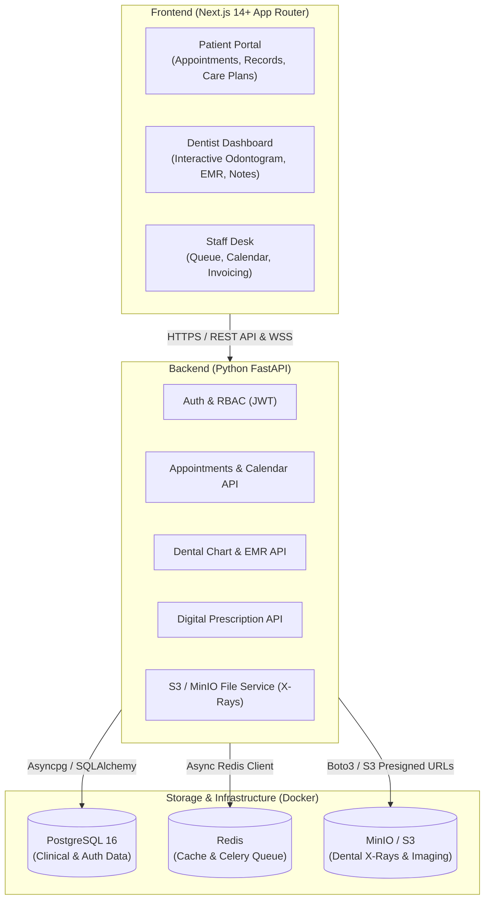
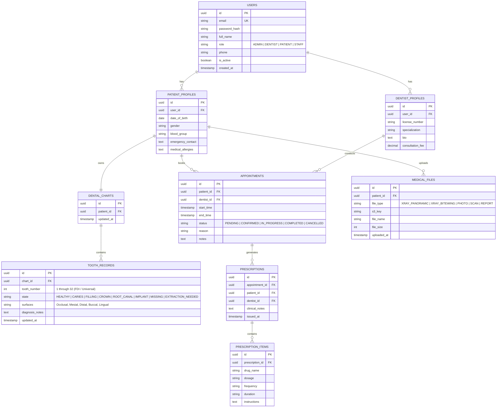

# DentalConnect: Platform Architecture & Implementation Plan

> [!NOTE]
> **DentalConnect** is a specialized clinical and patient management platform designed for dental practices. It pairs an interactive tooth-by-tooth dental chart (odontogram) and clinical EMR with patient appointment scheduling, digital prescriptions, and secure imaging storage.

---

## 1. System Architecture Overview

The system follows a clean modular monorepo architecture with decoupled frontend and backend services communicating over REST (with WebSockets for real-time schedule updates and chat).



---

## 2. Overall Repository Structure

A monorepo structure ensures unified development, shared Docker environments, and easy full-stack testing:

```
dentalconnect/
├── .env.example                     # Unified environment template
├── .gitignore
├── README.md
├── docker-compose.yml               # Local orchestration (DB, Cache, Storage, App)
├── docker-compose.override.yml      # Local dev overrides with live reloading
│
├── backend/                         # FastAPI Python Backend
│   ├── Dockerfile
│   ├── pyproject.toml / requirements.txt
│   ├── alembic.ini                  # Alembic DB migration config
│   ├── alembic/                     # Migration versions
│   │   ├── env.py
│   │   └── versions/
│   └── app/
│       ├── __init__.py
│       ├── main.py                  # App entrypoint & CORS config
│       ├── core/                    # App configuration, security, DB session
│       │   ├── config.py
│       │   ├── database.py
│       │   └── security.py          # JWT, Argon2/bcrypt password hashing
│       ├── models/                  # SQLAlchemy 2.0 ORM Models
│       │   ├── user.py
│       │   ├── patient.py
│       │   ├── dentist.py
│       │   ├── appointment.py
│       │   ├── dental_chart.py      # Odontogram & tooth records
│       │   ├── prescription.py
│       │   └── medical_file.py      # X-ray metadata
│       ├── schemas/                 # Pydantic v2 validation schemas
│       │   ├── auth.py
│       │   ├── appointment.py
│       │   ├── dental_chart.py
│       │   └── prescription.py
│       ├── api/                     # REST API route handlers (v1)
│       │   ├── v1/
│       │   │   ├── api.py           # Combined router
│       │   │   ├── endpoints/
│       │   │   │   ├── auth.py
│       │   │   │   ├── patients.py
│       │   │   │   ├── dentists.py
│       │   │   │   ├── appointments.py
│       │   │   │   ├── charts.py    # Tooth charting & updates
│       │   │   │   ├── prescriptions.py
│       │   │   │   └── files.py     # Presigned S3 upload/download
│       └── services/                # Business logic & external clients
│           ├── storage.py           # MinIO / S3 helper
│           └── reminder.py          # Notification triggers
│
├── frontend/                        # Next.js 14+ (TypeScript + Tailwind CSS)
│   ├── Dockerfile
│   ├── package.json
│   ├── tsconfig.json
│   ├── tailwind.config.ts
│   ├── next.config.mjs
│   └── src/
│       ├── app/                     # Next.js App Router
│       │   ├── layout.tsx
│       │   ├── page.tsx             # Landing / Welcome page
│       │   ├── (auth)/
│       │   │   ├── login/page.tsx
│       │   │   └── register/page.tsx
│       │   ├── (dashboard)/
│       │   │   ├── layout.tsx       # Sidebar, Header, Role Guard
│       │   │   ├── appointments/    # Calendar & booking views
│       │   │   ├── patients/        # Patient list & profiles
│       │   │   │   └── [id]/
│       │   │   │       ├── page.tsx
│       │   │   │       └── chart/page.tsx # Interactive Odontogram
│       │   │   ├── prescriptions/
│       │   │   └── settings/
│       ├── components/              # Reusable UI components
│       │   ├── ui/                  # Buttons, Modals, Forms, Badges (Shadcn/Radix)
│       │   ├── odontogram/          # Interactive 32-Tooth Chart
│       │   │   ├── Tooth.tsx        # Single tooth SVG with clickable surfaces
│       │   │   ├── ToothDetailsModal.tsx # Mark cavity/filling/crown/root-canal
│       │   │   └── DentalChart.tsx  # Full upper & lower dental arch
│       │   ├── calendar/            # Week/Day appointment view
│       │   └── layout/              # Navbars, Sidebars
│       ├── hooks/                   # React custom hooks
│       ├── lib/                     # API client (Axios/Fetch), auth helpers
│       └── types/                   # TypeScript DTO interfaces
│
└── storage/                         # Local volume mount for MinIO & Postgres data
```

---

## 3. Database Schema & Data Models



---

## 4. Key Functional Modules

### A. Interactive Odontogram (Dental Chart)
* **Standard Adult 32-Tooth System** (numbered 1–32 Universal Numbering System with FDI World Dental Federation 11-48 toggle).
* **Clickable Anatomy**: Individual tooth surfaces can be clicked (Mesial, Distal, Occlusal, Buccal/Facial, Lingual).
* **Condition Marking**: Color-coded visualization:
  * 🟢 Healthy
  * 🔴 Caries / Cavity (Active decay)
  * 🔵 Restored / Existing Filling
  * 🟡 Crown / Bridge
  * 🟣 Root Canal Treatment (Endodontic)
  * ⚪ Missing tooth
  * 🟤 Dental Implant
* **Historical Treatment Timeline**: See how a patient's mouth evolved over visits.

### B. Smart Appointment Scheduling
* Dentists set working hours, break times, and slot durations (e.g., 30 mins, 45 mins).
* Conflict prevention: No double bookings.
* Status tracking: `Requested` $\rightarrow$ `Confirmed` $\rightarrow$ `Checked-In` $\rightarrow$ `Completed`.

### C. Digital Prescriptions & Treatment Estimates
* One-click PDF generation for prescriptions.
* Treatment plan cost estimator (itemized procedures per tooth with total quote).

### D. Dental Imaging & X-Rays
* Direct upload of DICOM / High-Res JPEG / PNG panoramic X-rays.
* Presigned URLs for secure temporary viewing without exposing raw file bucket storage to the public.

---

## 5. Technology Stack Summary

| Layer | Component | Details |
|---|---|---|
| **Backend** | Python 3.12 + FastAPI | Fast asynchronous REST API with auto OpenAPI/Swagger docs |
| **ORM & Migrations** | SQLAlchemy 2.0 (Async) + Alembic | Type-safe queries and versioned DB migrations |
| **Frontend** | Next.js 14+ (App Router) + TypeScript | React Server Components, responsive layout, SEO-ready |
| **Styling & UI** | Tailwind CSS + Lucide Icons + Shadcn UI | Clean clinical aesthetic with high accessibility |
| **Database** | PostgreSQL 16 (in Docker) | Relational integrity, JSONB support for clinical notes |
| **File Storage** | MinIO (Docker) / AWS S3 | Secure bucket storage for X-rays and scans |
| **Cache & Tasks** | Redis + Celery / ARQ | Task scheduling for email/SMS appointment reminders |

---

## 6. Implementation Milestones

> [!IMPORTANT]
> The development is divided into incremental phases:

1. **Phase 1: Environment & Orchestration**
   * Set up `docker-compose.yml` with PostgreSQL 16, Redis, MinIO, and network bridges.
   * Initialize FastAPI backend boilerplate and Next.js frontend skeleton.
2. **Phase 2: Database Models & Migrations**
   * Create SQLAlchemy models for Users, Profiles, Appointments, Dental Charts, Teeth, and Prescriptions.
   * Generate initial Alembic migration scripts and seed test data.
3. **Phase 3: Core REST API & Authentication**
   * Implement JWT login, signup, role guards (Patient, Dentist, Staff).
   * CRUD endpoints for Appointments, Odontogram teeth updates, and Prescriptions.
4. **Phase 4: Next.js Frontend Shell & Dashboards**
   * Role-based layout with responsive sidebar and authenticated sessions.
   * Patient booking portal and doctor calendar.
5. **Phase 5: Interactive Odontogram Component**
   * Build the SVG-based 32-tooth dental arch with color-coded condition selector modal.
6. **Phase 6: Prescriptions, X-Ray Uploads & Polish**
   * Presigned image uploads to MinIO/S3.
   * Print-ready digital prescription view.
