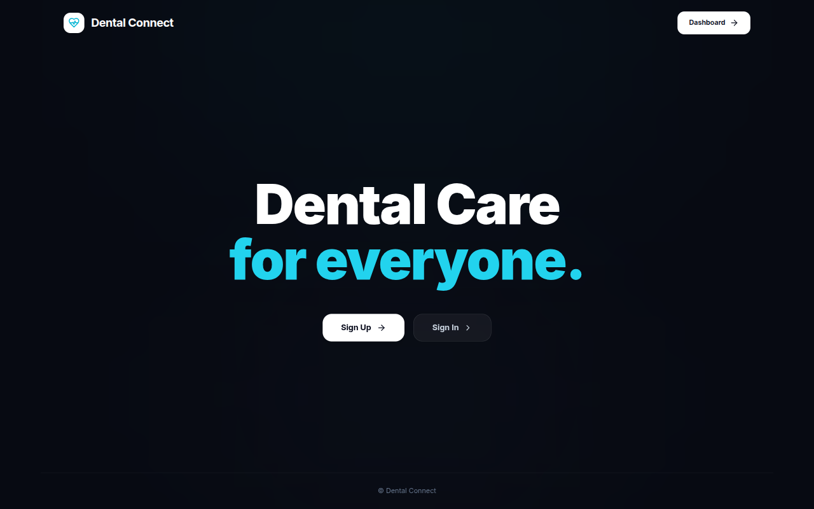
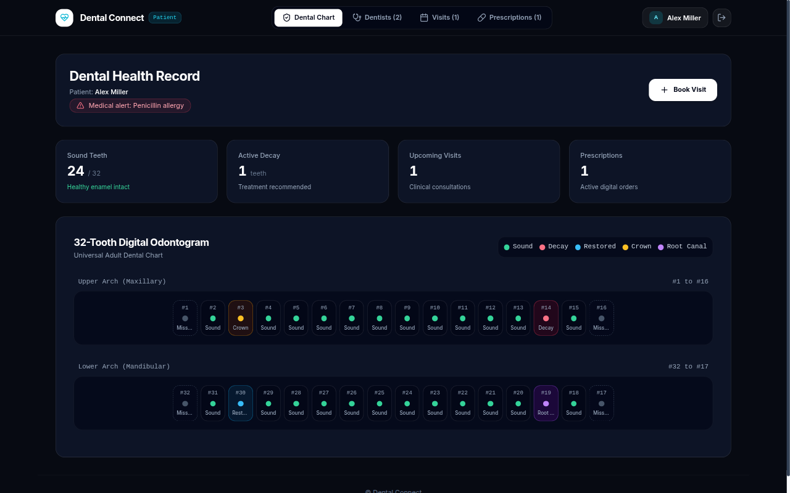
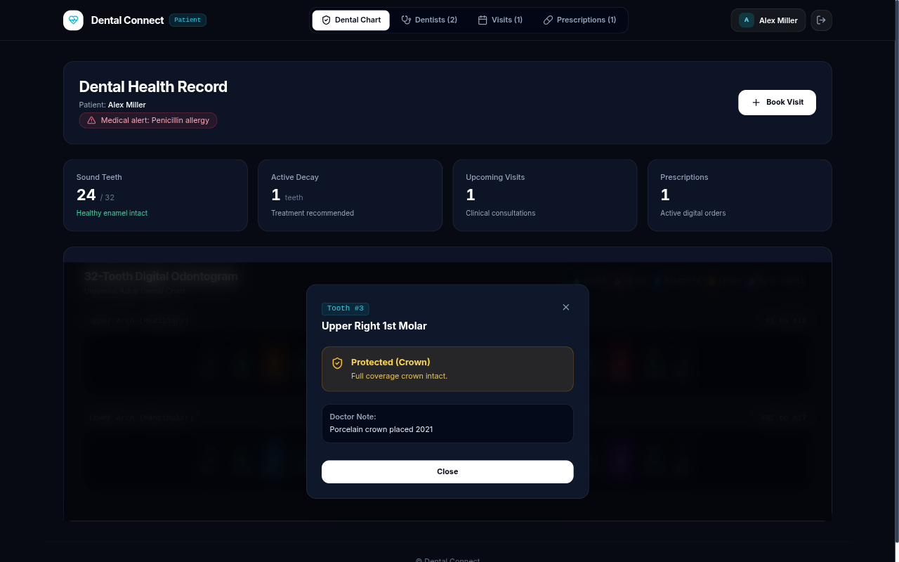
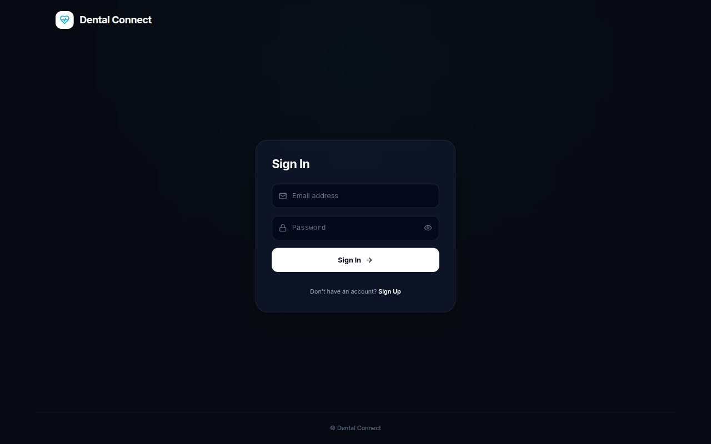
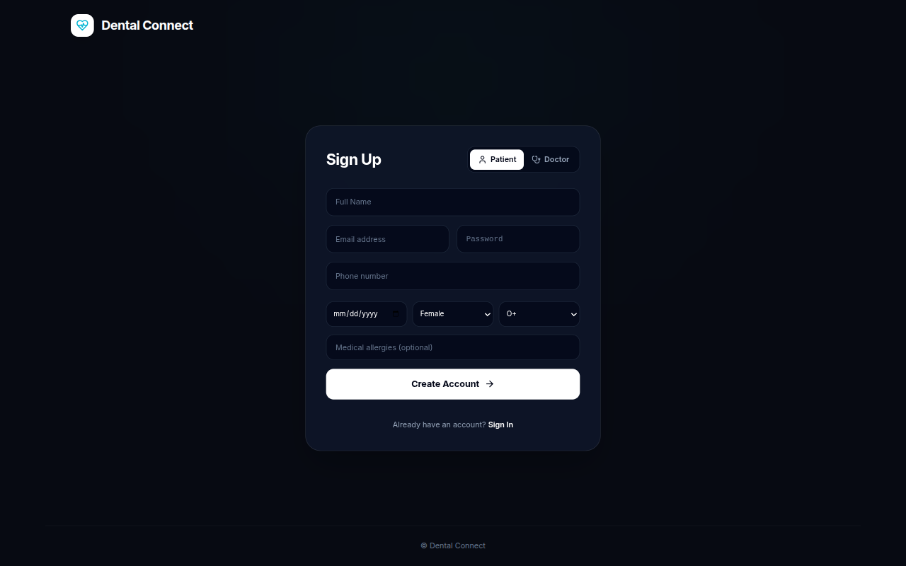

# Dental Connect

> Precision oral healthcare platform connecting patients and dental clinicians through real-time chairside charting, transparent scheduling, and digital prescriptions.

[](LICENSE)
[](https://nextjs.org/)
[](https://fastapi.tiangolo.com/)
[](https://www.postgresql.org/)

---

## Product Overview

Dental Connect is built around a single design philosophy: zero fluff, total utility. Healthcare software often suffers from visual clutter, confusing marketing text, and dense interfaces. Dental Connect strips away all decorative filler to deliver an intentional, distraction-free environment for both patients and clinicians.



---

## Design System

The platform is designed around the **60-30-10** color rule and single-viewport spatial discipline:

* **60% Obsidian Canvas (`#070a12`)**: A distraction-free deep dark backdrop that reduces visual fatigue during clinical operatory work and keeps attention focused on clinical data.
* **30% Pure White Structure (`#ffffff`)**: High-contrast typography, primary card surfaces, and primary action buttons.
* **10% Electric Cyan Pop (`#00f0ff` / `text-cyan-400`)**: Reserved strictly for focal words, active states, and clinical highlights.
* **Zero Fluff**: No decorative filler text, no marketing badges, and no public exposure of confidential clinical data prior to authentication.

---

## Core Capabilities

### 1. Interactive 32-Tooth Digital Odontogram

Patients and clinicians inspect an anatomical representation of the adult dentition mapped in standard Universal notation (Teeth #1 to #32).



* **Upper Arch (Maxillary)**: Teeth #1 to #16 mapped right-to-left.
* **Lower Arch (Mandibular)**: Teeth #32 to #17 mapped right-to-left.
* **Color-Coded Diagnostic States**:
  * **Sound (Emerald)**: Intact natural enamel.
  * **Decay (Rose)**: Active surface caries requiring restorative care.
  * **Restored (Sky Blue)**: Composite or amalgam restoration.
  * **Crown (Amber)**: Full-coverage ceramic or porcelain crown.
  * **Root Canal (Purple)**: Endodontic therapy completed.
  * **Implant (Indigo)**: Integrated titanium dental implant.
* **Interactive Tooth Inspection**: Selecting any tooth reveals condition summaries, clinical notes, and hygiene advice.



---

### 2. Streamlined Authentication

Authentication is unified into focused, single-purpose cards with no marketing sidebars or distracting text.

| Sign In (`/login`) | Sign Up (`/register`) |
| :---: | :---: |
|  |  |
| Direct email and password credentials with automatic role dispatch to patient, doctor, or admin portals. | Fast segmented role toggle between Patient and Dental Practitioner with board review workflows. |

---

### 3. Direct Visit Scheduling

* **Clinician Directory**: Patients browse verified practitioners with transparent consultation fees and state board credentials.
* **Real-Time Booking**: Select clinical reasons, appointment slots, and symptoms directly into the practitioner's operatory queue.

---

### 4. Digital Prescription Pad

* Encrypted electronic prescriptions issued chairside by practitioners.
* Itemized medication ledgers with dosage, frequency, course duration, and administration guidance.
* Immediate patient record availability without paper slips.

---

## Architecture & Tech Stack

```
+-------------------------------------------------------------+
|                     Next.js 14 Frontend                     |
|         (App Router, TypeScript, Tailwind CSS, Lucide)      |
+------------------------------+------------------------------+
                               | REST API (JSON / JWT)
                               v
+-------------------------------------------------------------+
|                     FastAPI Backend                         |
|         (Python 3.12, Pydantic v2, SQLAlchemy 2.0)          |
+------------------------------+------------------------------+
                               |
            +------------------+------------------+
            |                                     |
            v                                     v
+-----------------------+             +-----------------------+
|  PostgreSQL 16 Engine |             | MinIO S3 File Storage |
| (SQLite dev fallback) |             | (X-Rays & Documents)  |
+-----------------------+             +-----------------------+
```

* **Frontend**: Next.js 14 with App Router, React 18, TypeScript, Tailwind CSS, and Lucide icons.
* **Backend**: FastAPI with Python 3.12, Pydantic v2 schemas, and asynchronous SQLAlchemy 2.0.
* **Database**: PostgreSQL 16 (production) with automatic local SQLite fallback (`backend/dentalconnect.db`) for instant zero-dependency development.
* **Object Storage**: MinIO for S3-compatible dental radiograph storage.
* **Authentication**: JWT access tokens with role-based route guards (`PATIENT`, `DENTIST`, `ADMIN`).

---

## Quick Start

### Option A: Complete Docker Compose Stack

Run the entire ecosystem with one command:

```bash
docker compose up -d
```

Service endpoints:
* **Frontend Web Application**: [http://localhost:3000](http://localhost:3000)
* **FastAPI Swagger Documentation**: [http://localhost:8000/docs](http://localhost:8000/docs)
* **MinIO Console**: [http://localhost:9001](http://localhost:9001) (User: `minio_admin`, Password: `minio_secret_key`)

---

### Option B: Native Local Development

Run the backend and frontend locally with hot-reloading:

#### 1. Backend Setup (FastAPI)

```bash
cd backend
python3 -m venv venv
source venv/bin/activate
pip install -r requirements.txt

# Initialize database schema and seed clinical demo accounts
python app/seed.py

# Start the API server
uvicorn app.main:app --host 0.0.0.0 --port 8000 --reload
```

The backend automatically utilizes the local SQLite database fallback when Docker PostgreSQL is offline.

#### 2. Frontend Setup (Next.js)

```bash
cd frontend
npm install
npm run dev
```

Open [http://localhost:3000](http://localhost:3000) in your browser.

---

## Demo Accounts

Pre-seeded clinical accounts ready for instant testing:

| Role | Email | Password | Access Route |
| :--- | :--- | :--- | :--- |
| **Patient** | `alex@example.com` | `Password123!` | `/patient` |
| **Dentist** | `dr.vance@dentalconnect.com` | `Password123!` | `/doctor` |
| **Admin** | `admin@dentalconnect.com` | `AdminSecure123!` | `/admin` |

---

## Repository Structure

```
dentalconnect/
├── docs/
│   └── images/              # High-resolution application screenshots
│       ├── landing.png
│       ├── login.png
│       ├── register.png
│       ├── patient-portal.png
│       └── tooth-modal.png
│
├── frontend/                # Next.js 14 client application
│   ├── src/app/
│   │   ├── page.tsx         # Minimal hero landing page
│   │   ├── (auth)/
│   │   │   ├── login/       # Sign in page
│   │   │   └── register/    # Sign up page
│   │   ├── patient/         # Patient health record & odontogram
│   │   ├── doctor/          # Clinician operatory workspace
│   │   └── admin/           # Administrative governance console
│   └── src/components/
│       ├── layout/          # Global AppNavbar
│       ├── patient/         # Patient odontogram & tooth modal
│       └── appointments/    # Appointment booking modal
│
├── backend/                 # FastAPI REST API
│   ├── app/
│   │   ├── api/v1/          # Endpoints (auth, dentists, patients, charts, rx)
│   │   ├── core/            # Database session, config, security
│   │   ├── models/          # SQLAlchemy ORM models
│   │   ├── schemas/         # Pydantic v2 validation models
│   │   └── seed.py          # Clinical sample database seeder
│   └── requirements.txt
│
└── docker-compose.yml       # Production services orchestration
```

---

## License

This project is licensed under the MIT License.
