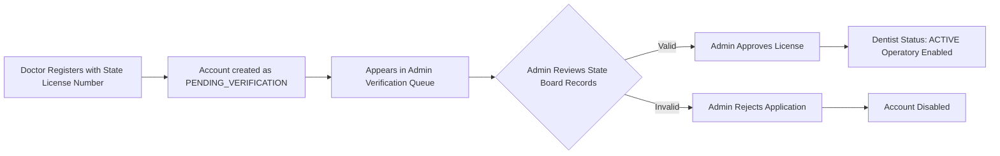

# Doctor License Verification Workflow

To protect patients and maintain clinical compliance, healthcare providers cannot immediately begin seeing patients upon registration. They must pass administrator verification.

---

## Verification Pipeline



### 1. Registration (`PENDING_VERIFICATION`)
When a dentist registers, they must provide:
- Full Legal Name
- State Dental Board License Number (e.g. `DDS-98421-CA`)
- Clinical Specialization (General Dentistry, Endodontics, Orthodontics, Periodontics)
- Years of Clinical Experience
- Consultation Fee

Their `verification_status` is initialized to `PENDING_VERIFICATION`, and their user account remains restricted.

### 2. Administrator Review Queue
Clinic administrators access `/admin` and see the **Pending License Applications** table:
```http
GET /api/v1/admin/verifications/pending
Authorization: Bearer <admin_token>
```

### 3. Approval or Rejection
- **Approve**:
  ```http
  POST /api/v1/admin/verifications/{dentist_id}/approve
  ```
  Sets `dentist_profiles.verification_status = 'ACTIVE'`, logs `verified_at` and `verified_by`, and sets `users.is_active = 1`. The dentist can now log in to `/doctor` and accept appointments.
- **Reject**:
  ```http
  POST /api/v1/admin/verifications/{dentist_id}/reject
  ```
  Marks application rejected and disables the account.
