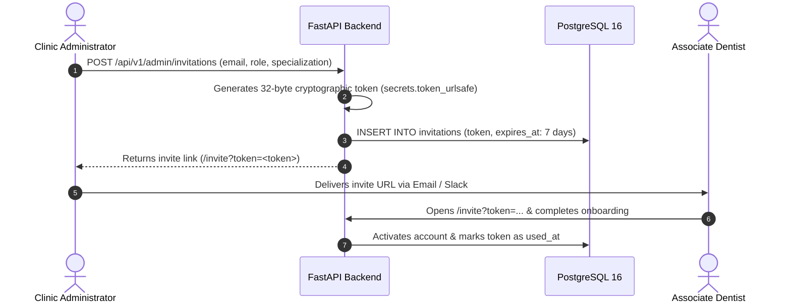

# Practitioner & Staff Invitations

Dental clinics frequently onboard associate dentists, dental hygienists, and reception staff. DentalConnect provides a tokenized invitation system to streamline this process securely.

---

## Invitation Workflow

---

## Invitation Token Specifications

- **Cryptographic Entropy**: Generated using Python's `secrets.token_urlsafe(32)`.
- **Expiration Window**: Valid for exactly 7 days (`now + timedelta(days=7)`).
- **Single-Use Guard**: Once an invite is consumed, the `used_at` timestamp is written. Re-use attempts are rejected with `400 Bad Request`.
- **Pre-Assigned Role**: The token pre-determines whether the recipient joins as `DENTIST` or `STAFF`, preventing privilege escalation.
