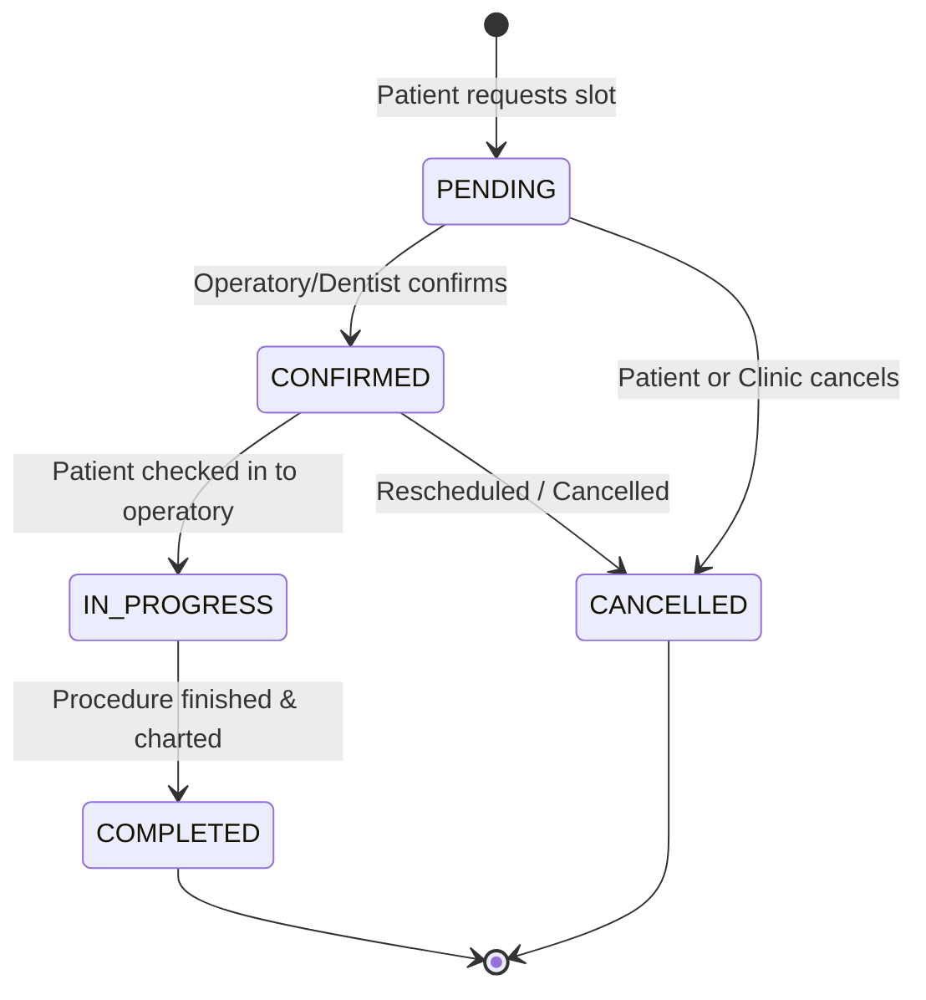

# Appointments & Scheduling

DentalConnect includes an appointment booking and lifecycle tracking engine designed to reduce patient no-shows and optimize chair time.

---

## Appointment Lifecycle States

Appointments advance through a clear status workflow:



- **`PENDING`**: Initial state when an appointment is booked via self-service portal.
- **`CONFIRMED`**: Scheduled into the dentist's active operatory calendar.
- **`IN_PROGRESS`**: Patient is currently seated in the operatory chair.
- **`COMPLETED`**: Treatment finished, procedure codes entered into the treatment ledger.
- **`CANCELLED`**: Cancelled with audit trail.

---

## Clinical Visit Types

When booking an appointment, patients select from standardized clinical categories:
- **Comprehensive Exam & Cleaning**: Routine prophylaxis and bitewing check.
- **Toothache / Emergency Triage**: Acute pain, swelling, trauma, or fractured tooth.
- **Restorative (Filling)**: Composite restoration of diagnosed caries.
- **Endodontic Consultation**: Evaluation for root canal therapy.
- **Crown & Bridge**: Prosthetic impression or cementation.
- **Orthodontic / Clear Aligner Check**: Progress check for aligners or wire adjustment.
- **Wisdom Tooth Evaluation**: Panoramic review of impacted third molars.

---

## Conflict Prevention & Slot Duration

By default, DentalConnect structures appointments into 45-minute clinical blocks with 15-minute sanitization/turnaround buffers. 

```json
{
  "dentist_id": "29025489-5c5c-4742-9b37-d864a1e214cc",
  "start_time": "2026-11-25T10:00:00Z",
  "end_time": "2026-11-25T10:45:00Z",
  "reason": "Filling procedure for Tooth #14 (Upper Left First Molar)",
  "clinical_notes": "Patient reports cold sensitivity."
}
```
