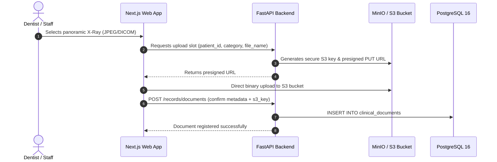

# Clinical Documents & Radiographs

Dental diagnosis depends heavily on medical imaging. DentalConnect provides a specialized metadata registry (`clinical_documents`) integrated with S3/MinIO object storage to manage dental radiographs and clinical files.

---

## Supported Imaging & Document Categories

- **`XRAY_PANORAMIC`**: Full-jaw panoramic radiograph showing maxilla, mandible, sinuses, and TMJ.
- **`XRAY_BITEWING`**: Interproximal bitewing radiographs used for detecting decay between teeth and crestal bone levels.
- **`XRAY_PERIAPICAL`**: High-detail views of a single tooth crown down to the root apex and surrounding alveolar bone.
- **`PHOTO_INTRAORAL`**: High-resolution intraoral camera photos showing enamel fractures, plaque, or soft tissue lesions.
- **`SCAN_3D_CBCT`**: Cone-Beam Computed Tomography scans used for implant planning and endodontic canal anatomy.
- **`CONSENT_FORM`**: Signed procedural consent agreements (e.g., surgical extractions, sedation).
- **`LAB_SLIP`**: Dental lab work orders for crowns, dentures, and clear aligners.

---

## MinIO / S3 Storage Pipeline

### Security Benefits
- **Zero Server Bottleneck**: Large radiographic image files (15MB–50MB) stream directly to S3/MinIO storage without loading into Python backend memory.
- **Expiring Access**: Raw bucket objects remain private. File retrieval uses short-lived presigned download URLs.
